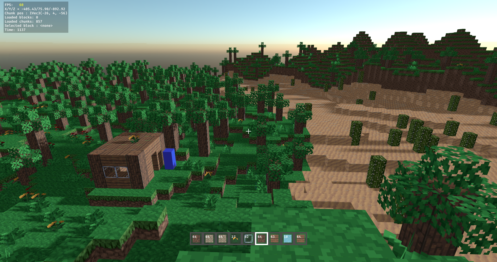
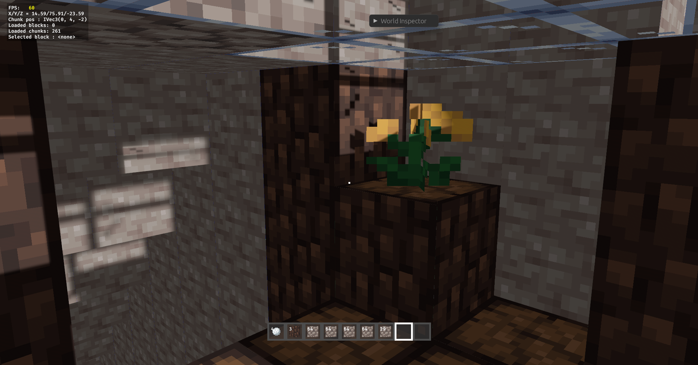

# rustcraft

Minecraft game clone written in Rust, using the Bevy game engine.

<br>





<br>

# Table of contents

- [Features](#features)
- [Installation](#installation)
    - [Package Managers](#package-managers)
    - [Manual](#manual)
- [Controls](#controls)
- [Multiplayer](#multiplayer)
- [Saves](#saves)
- [How to Build](#how-to-build)
    - [Prerequisites](#prerequisites)
    - [Running the Project](#running-the-project)
- [Contributing](#contributing)
    - [Guidelines](#guidelines)

<br>

# Features
- Procedurally generated worlds with biomes (Plains, Forest, Mountains, Desert, Ice Plain, Flower plains), trees, cactus, tall grass and flowers.
- Multiplayer functionality.
- Day/night cycle
- Block breaking and placing mechanics.
- Inventory system with a functional hotbar.
- World saving and loading.
- In-game chat.
- Customizable keybindings, and a render distance set in Settings > Video or with O and P.

<br>

# Installation

## Manual

You can download the game for **Windows** and **Linux** from the [Releases page](https://github.com/c2i-junia/rustcraft/releases) of the GitHub repository.

Once downloaded, extract the archive for your operating system. The executable will be located in the `/bin` folder of the extracted directory.

## Package Managers

### Arch Linux

There are 2 [AUR](https://aur.archlinux.org) packages available for rustcraft:

- [rustcraft](https://aur.archlinux.org/packages/rustcraft): The latest release built from source
- [rustcraft-bin](https://aur.archlinux.org/packages/rustcraft-bin): The latest release pre-built

You can install them using your preferred [AUR helper](https://wiki.archlinux.org/title/AUR_helpers), e.g. `paru`:
```bash
paru -S rustcraft
```

<br>

# Controls

| **Category**     | **Action**             | **Key(s)**                  |
|-------------------|------------------------|-----------------------------|
| **Movement**      | Jump                  | Space                       |
|                   | Strafe Left           | A / Arrow Left              |
|                   | Strafe Right          | D / Arrow Right             |
|                   | Walk Backward         | S / Arrow Down              |
|                   | Walk Forward          | W / Arrow Up                |
|                   | Toggle Fly Mode       | F                           |
|                   | Fly Up                | Space                       |
|                   | Fly Down              | Left Shift                  |
|                   |                        |                             |
| **Gameplay**      | Destroy Block         | Left Mouse Button           |
|                   | Place Block           | Right Mouse Button          |
|                   |                        |                             |
| **Hotbar**        | Select a slot         | 1–9                         |
|                   | Next / previous slot  | Mouse wheel                 |
|                   |                        |                             |
| **Inventory**     | Open/Close Inventory  | E                           |
|                   | Pick up stack         | Left Click                  |
|                   | Pick up half of stack | Right Click (with empty mouse) |
|                   | Deposit 1 item        | Right Click (over valid stack) |
|                   | Deposit MAX items     | Left Click (over valid stack) |
|                   | Exchange stacks       | Left Click (over a different stack or full valid stack) |
|                   | Move a stack between backpack and hotbar | Shift + Left Click |
|                   | Swap with a hotbar slot | 1–9 over a slot          |
|                   | Move between slots     | Arrows                      |
|                   | Take / place           | Enter                       |
|                   | Take half / place one  | Space                       |
|                   | Move to the backpack / hotbar | Shift+Enter          |
|                   |                        |                             |
| **Chat**          | Open the chat         | T                           |
|                   | Open the chat with a slash | /                      |
|                   | Send / close           | Enter / Escape              |
|                   | Recall sent messages   | ↑ / ↓ in the chat           |
|                   | Scroll the chat        | PageUp / PageDown, mouse wheel |
|                   |                        |                             |
| **Miscellaneous** | Game menu             | Escape                      |
|                   | Reload Chunks (rebuild their meshes) | R            |
|                   | Toggle debug overlay  | F3                          |
|                   | Toggle Perspective    | F5                          |
|                   | Toggle Chunk Debug    | F4                          |
|                   | Toggle Block Debug    | F6                          |
|                   | Toggle Raycast Debug  | F7                          |
|                   | Decrease Mob Draw Distance | O                      |
|                   | Increase Mob Draw Distance | P                      |

<br>

# Multiplayer

The Multiplayer screen lists your servers with their status: players, latency, or why they
cannot be joined. An address is a host name or an IPv4 address, with or without a port
(`play.example.com`, `10.0.0.2:8000`); the port is 8000 when it is left out.

A dedicated server (`rustcraft-server --port 8000`) listens for the game on UDP port `port`
(8000 by default), and answers the status requests of the server list on UDP port `port + 1`.
Open both in a firewall or a router: a server whose status port cannot be reached, or an older
server that has none, shows as "Offline" in the list, and can still be joined.

Each player sets its render distance, from 1 to 8 chunks, in Settings > Video or with O and
P; the server sends the chunks within it, up to `--max-render-distance` chunks (6 by default),
and the Video tab says when it grants less. A world of Singleplayer grants all 8. A distance of `d` is (2d + 1)³ chunks per
player, so a high maximum costs the server memory and generation time.

While a world opens or a server is joined, a card shows each step and can be cancelled with
Escape. When it fails, a card says why, with the way back to the list and, when it may help,
"Try again":

- **Cannot reach "…"**: the server did not answer within 10 seconds. Check that it is running
  and that its two UDP ports, the game port and the game port + 1, are open in its firewall and
  forwarded by its router.
- **"…" runs another version**: join with the same version of Rustcraft as the server.
- **"…" is full**: the server has no room for another player; try again later.
- **"…" refused you**: the server closed the connection before letting you in, most often
  because a player with your name is already on it. Start the game with another name:
  `rustcraft --player-name <name>`.
- **Your name is not accepted**: a player name has 1 to 32 characters and no control
  characters. Start the game with another `--player-name`.
- **Connection to "…" lost**, **"…" stopped**: the server stopped answering, or shut down.
  Check your network, or ask whoever runs the server, then try again.
- **Cannot open "…"** (a world): the world could not be loaded, and the card gives the reason,
  often its `world.ron`; or the last world played is still closing, and this one opens in a
  moment.

<br>

# Saves

Each world has its own folder under `saves/`: `world.ron` holds the metadata (name, seed, time, mobs), `chunks/` has one file per chunk and `players/` one file per player. The game saves every 60 seconds, when a player leaves and when the game is closed. "Save now" in the game menu saves at once and says when the world is written. Closing the window in a world saves it first, with a card saying so; closing it again quits at once. Worlds saved by older versions are converted on their first load, and the old file is kept as `world.ron.legacy`. The Singleplayer screen writes `world.ron` when it creates a world, renames the folder and the name in `world.ron` when it renames one, and deletes the folder, after asking, when it deletes one. The server list is `servers.ron`, in the game folder: the Multiplayer screen writes it at once after every add, edit and remove.

The settings are saved as soon as they change, in the game folder: `keybindings.ron`, `audio.ron`, `interface.ron` (UI scale) and `video.ron` (render distance).

<br>

# How to Build

## Prerequisites

To build and run this project, you need the following tools and dependencies installed:

### 1. **Rust**
- Install Rust using [Rustup](https://rustup.rs)
- The repository pins its nightly toolchain (with the Cranelift backend) in `rust-toolchain.toml`: rustup installs it automatically on the first `cargo` command run in the repository.

### 2. **Just**
- **Just** is used in this project to manage build. Install it using Cargo:
  ```bash
  cargo install just
  ```
> Note: You can also install Just using your system's package manager.

### 3. **Dependencies**

Install the required dependencies based on your operating system:

#### Windows
- **Git Bash** is required to ensure the commands in the `Justfile` and scripts run correctly. Download and install [Git Bash](https://git-scm.com/).
- After installation, make sure Git Bash is added to your system's `PATH`. You can verify it by running:
  ```bash
  bash --version
  ```

#### Arch Linux
```bash
sudo pacman -S base-devel mold clang vulkan-radeon vulkan-tools vulkan-swrast
```
- `vulkan-swrast` is the software renderer the UI screenshot tests draw with.
- Replace `vulkan-radeon` with:   
  - `vulkan-intel` for Intel GPUs.   
  - `nvidia-utils` for NVIDIA GPUs.   

#### Ubuntu/Debian
```bash
sudo apt install -y build-essential mold clang mesa-vulkan-drivers vulkan-tools pkg-config libasound2-dev libudev-dev
```
- For NVIDIA GPUs, also install:
    ```shell
    sudo apt install -y nvidia-driver nvidia-vulkan-icd
    ```

## Running the Project

To compile and run the game locally, use the following commands:

> Note: the first compilation will be slow depending on your hardware, next compilations will be incremental and thus faster.

```sh
# Clone the repository
git clone https://github.com/c2i-junia/rustcraft

# Navigate to the project directory
cd rustcraft
```

Debug mode:
```sh
./run1.sh        # this will compile the project and run the client 

./run-server.sh  # (optional) do this only to test multiplayer features
```

Release mode:
```sh
# Build the project in release mode
just generate-release-folder

# Run the executable
./release/bin/rustcraft         # run the client

./release/bin/rustcraft-server  # (optional) do this only to test multiplayer features
```

<br>

# Contributing

Feel free to submit issues or open pull requests. If you want to know where to help, refer to the existing issues.

[docs/ARCHITECTURE.md](./docs/ARCHITECTURE.md) explains how the three crates fit together, the order of a server tick and of a client frame, and the save format.

## Guidelines 

### Checks
Run `just check` before committing: it checks the formatting (`cargo fmt`), runs clippy without any warning allowed, and runs the tests. The CI runs the same three steps.

### UI screenshots
On Linux, the tests also draw the UI off screen and compare it with the golden screenshots of `client/tests/golden/`. They draw with lavapipe, the software renderer of Mesa (`vulkan-swrast` on Arch, `mesa-vulkan-drivers` on Ubuntu/Debian), so that every machine draws the same pixels.

- A test without a golden writes it and fails: look at the image, then commit it.
- After a deliberate change of the UI, `UPDATE_GOLDEN=1 cargo test -p client golden` rewrites the goldens: look at their diff before committing them.
- A test that fails writes `<name>.actual.png` and `<name>.diff.png`, with the differing pixels in red, next to the golden. The CI uploads them as the `golden-failures` artifact.

### End-to-end UI tests
The tests in `client/src/e2e/` run the whole client headless, with the same wiring as the game (`app::add_client`), and drive it like a player: they find elements on screen, click, type, and read what is drawn. They need no window, but, like the golden screenshots, they draw with lavapipe (see above) and are ignored on other systems than Linux. Each `Harness` has its own temporary game folder and no fixed network port, so tests run in parallel; in game, they go through the real integrated server.

- **Locators** (`Locator`, imported as `L`) describe what a player sees: `L::text("Singleplayer")` first, as text is what the player reads. For elements without text, use `L::name("ChatRoot")` (the `Name` of the element) or `L::marker::<Hotbar>()` (a component); a widget is found by the accessibility role and label every new widget carries, `L::role(Role::Button, "Play")`. `L::row("My world")` is the row of a text, and `locator.within(scope)` restricts a locator to the descendants of another. Hidden elements are never found, and a text made of spans is matched on its whole content. `L::text` and `L::text_containing` match displayed texts only, never the value of a text field: read a field with `h.value_of::<Marker>()`.
- **Real input**: `click` and `hover` move the cursor and send the button messages, which the UI systems read as for a mouse; `press`, `key_down` and `key_up` send keys, `type_text` characters, `scroll` the wheel. `click`, `hover` and `scroll` also send the window events that `bevy_picking` reads, so the `ui_widgets` work headless, and the keys carry their logical key (`Key::Enter`, `Key::ArrowLeft`, ...) as well as their physical one. A test never calls a system or changes a resource to do what a player does.
- **Waits**: a click is not a transition, so a test waits for its result with `wait_for(&locator, SCREEN)` or `wait_until("what", timeout, |world| ...)`. `SCREEN` (2 s) is for the screens, `STARTUP` (10 s) for the first screen of a client, slower to come on a busy machine, and `SERVER` (30 s) for what goes through the integrated server (loading a world, a chat message). A wait that times out, or a `get` that finds nothing, fails with the locator (or the description) it waited for, the texts visible on screen, and the line of the test; nothing hangs, and a watchdog aborts the whole test process, naming the test, when a harness lives longer than 300 s.

A test is a few lines:

```rust
#[test]
#[cfg_attr(not(target_os = "linux"), ignore = "needs lavapipe")]
fn singleplayer_opens_the_world_list() {
    let mut h = Harness::new();
    h.wait_for(&L::text("Singleplayer"), STARTUP);
    h.click(&L::text("Singleplayer"));
    h.wait_for(&L::text("Worlds"), SCREEN);
    assert_eq!(h.menu_state(), MenuState::Solo);
}
```

- **Goldens**: `h.assert_screenshot("menu_main")` compares the screen with `client/tests/golden/menu_main.png`, as described in "UI screenshots": `UPDATE_GOLDEN=1 cargo test -p client golden` rewrites them.
- **Review snapshots**: `h.snapshot("name")` saves the screen as `target/ui-snapshots/<test>/<name>_<width>x<height>.png` when `UI_SNAPSHOTS=1`, and does nothing otherwise. The ignored test `every_screen_at_three_resolutions` saves every screen at 800x600, 1280x720 and 1920x1080 (99 files): run `UI_SNAPSHOTS=1 cargo test -p client review -- --ignored` and look at them after a change of the UI.
- **What a test freezes**: only the behaviour we want. A known defect is not frozen by a test that passes with it: its test is written with the intended behaviour, `#[ignore = "defect: ..."]`, and enabled by the commit that fixes it.

### Commit messages:

- We follow the [Conventional Commit specification](https://www.conventionalcommits.org/en/v1.0.0/). Our commit types are inspired by the [Karma specification](http://karma-runner.github.io/6.4/dev/git-commit-msg.html)
  ```
  <type>[optional scope]: <description>

  [optional body]

  [optional footer(s)]
  ```

  Allowed <type> values: 
  - **feat** for a new feature for the user, not a new feature for build script. Such commit will trigger a release bumping a MINOR version.
  - **fix** for a bug fix for the user, not a fix to a build script. Such commit will trigger a release bumping a PATCH version.
  - **perf** for performance improvements. Such commit will trigger a release bumping a PATCH version.
  - **docs** for changes to the documentation.
  - **style** for formatting changes, missing semicolons, etc.
  - **refactor** for refactoring production code, e.g. renaming a variable.
  - **test** for adding missing tests, refactoring tests; no production code change.
  - **build** for updating build configuration, development tools or other changes irrelevant to the user.

- Write commit messages in the present tense (e.g., "Add feature X" instead of "Added feature X").

### Branches
- Use the naming convention `<type>/<name>` for branches introducing new features. Only use lowercase letters, numbers, and dashes.
- The `main` branch should always compile successfully and be free of warnings. Use `cargo check`.
- Experimental branches are allowed to include code that does not build successfully.
- Prefer rebasing over merging.
