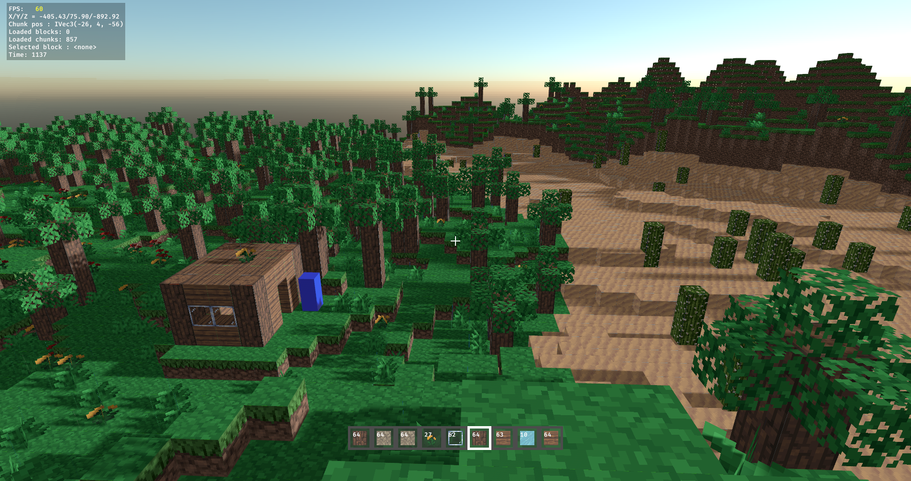
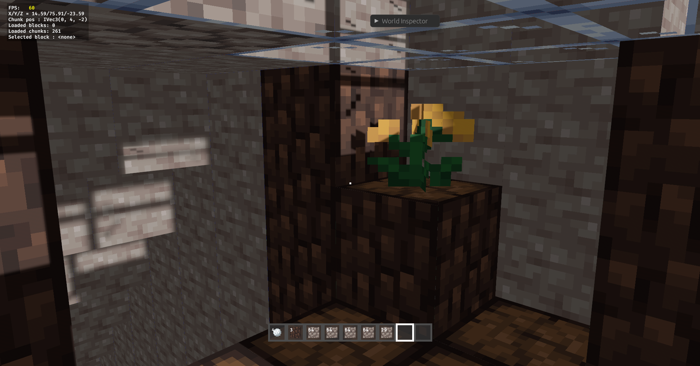

# rustcraft

Minecraft game clone written in Rust, using the Bevy game engine.

<br>





<br>

# Table of contents

- [Features](#features)
- [Installation](#installation)
    - [Package Managers](#package-managers)
    - [Manual](#manual)
- [Controls](#controls)
- [Multiplayer](#multiplayer)
    - [Operators, bans and the whitelist](#operators-bans-and-the-whitelist)
- [Saves](#saves)
- [Command-line options](#command-line-options)
    - [Client](#client)
    - [Server](#server)
- [How to Build](#how-to-build)
    - [Prerequisites](#prerequisites)
    - [Running the Project](#running-the-project)
- [Contributing](#contributing)
    - [Guidelines](#guidelines)

<br>

# Features
- Procedurally generated worlds with biomes (Plains, Forest, Mountains, Desert, Savanna, Jungle, Ice Plain, Ice Spikes, Flower plains, Flower forest, Grove, rivers and oceans), trees, cactus, tall grass, ferns and flowers, in four world types: default, large biomes, archipelago and single biome.
- Villages whose villagers trade, dungeons with loot and guards, and, at the bottom of the world, the Ember Mother, a boss that a depths compass points to. Below ground, hostile mobs get harder and more rewarding with depth.
- Multiplayer, on a dedicated server with operators, bans and a whitelist.
- Day/night cycle
- Block breaking and placing mechanics.
- Inventory system with a functional hotbar.
- An item browser beside the open inventory: every item of the game, searched by name or by `#category` and filtered by category chips; a drawer at the right edge in a small window. It is also the recipe book: the recipes and the uses of any item, the furnace's included, the ingredients you lack in red, in Survival what you can craft now, and a button that fills the crafting grid with a recipe, or lays a faint ghost of it over the grid, the lacking cells in red, when ingredients are missing. Ctrl+click on an item fills the grid with its first recipe made now, without opening it. In Creative it hands out stacks of any item, and destroys the stack you hold. A over any item slot bookmarks its item: the bookmarks show above the list, kept for each world and each server, and a Recent row under them holds the last items crafted in the session.
- World saving and loading.
- Survival and creative game modes: in survival, players have 10 hearts and cannot fly. They get hurt by falls of more than 3 blocks, run out of air under water, burn in fire and lava, starve, and get attacked by the hostile mobs; the death screen tells what killed them. A dead player drops its whole inventory where it died, for 5 minutes, and respawns at its bedroll or the spawn of the world. New players start in survival.
- Hunger: 10 drumsticks that efforts empty and food fills: meats raw and roasted, bread, berries, carrots, potatoes. Health only comes back well fed, a hungry player cannot sprint, and an empty bar starves.
- Fire, lit with a flint and steel, which spreads through what burns and goes out in the rain; and lava, which flows, sets things on fire, fills the bottom of the caves and hardens into obsidian or cobblestone where water meets it.
- Seven hostile mobs, which spawn in the dark: Gnawers, Brambles, Rollers, Stumplings, Drowners, Cinderlings, which throw embers, and Gust Owls, which dive at the players of the peaks. Blows knock them back; each drops its loot. `/difficulty peaceful` keeps them away.
- A furnace that smelts with an input, a fuel and an output slot, also while nobody watches it, as long as its chunk is loaded: iron and gold ore into ingots, diamond ore into diamonds, sand into glass, cobblestone into stone and logs into charcoal. Coal and charcoal burn for 8 items, wood for 1.5, wooden tools and sticks for less. Lit, it glows; it keeps what it holds in the save and drops it when broken.
- Tool tiers: wooden, stone, iron, golden and diamond pickaxes, axes, shovels, hoes and swords, each tier faster and longer-lasting (gold is the fastest and wears out the soonest). Ores need a pickaxe of their level, or they break without dropping anything: a wooden one for coal, a stone one for iron, an iron one for gold and diamonds, found deep underground. Nine ingots or diamonds make a block of iron, gold or diamond, and a block gives them back.
- Bow and arrows, a spear, and armour of leather, bronze, iron and diamond.
- Experience, spent on enchantments at an engraving table: efficiency, durability, sharpness, protection and bow power.
- Ten kinds of animals, each with its voice, which breed; wolves and cats are tamed and follow their owner.
- Skins to choose from or to import, worn by a body the other players see; sounds and original music.
- A world map and a minimap.
- A bucket, of three iron ingots, takes a water source and pours it elsewhere, where it flows.
- Weather: clear spells, rain and thunderstorms follow each other on their own, the same for every player and kept in the save. Rain rolls in under thicker, darker clouds and a grey sky that dims the light and closes the fog in; drops slanted by the wind splash on the ground and ring the water, but not under a roof or the leaves; snow falls in the cold, nothing in the deserts. In the High and Ultra shaders the ground open to the rain darkens, glistens and gathers puddles that mirror the sky, and dries after. Thunderstorms strike lightning that lights the world and the clouds, its thunder heard after the flash. The rain hisses in the open and drums on a roof, at its own Weather volume in Settings > Audio.
- Sprinting, sneaking and swimming.
- Portals: with the portal gun (`/give portal_gun 1`), a left click shoots your blue portal at a wall, a floor or a ceiling and a right click your orange one: a glowing bolt flies there, every player sees it, and the portal opens where it lands. Through each, you see what lies in front of the other, yourself included, and two facing portals show each other three times over; walk or fall in and you come out of the other, keeping your speed.
- Credits, opened from the main menu. [docs/ASSETS.md](./docs/ASSETS.md) says where the textures, sounds and fonts come from.
- In-game chat, with commands completed as they are typed (Tab, ↑↓): `/time set <day|night>`, `/give <item> <count>` (e.g. `/give oak_log 64`), `/gamemode <creative|survival>`, `/weather <clear|rain|thunder>`, `/difficulty <peaceful|easy|normal|hard>` and `/locate <biome|village|ruin|crypt|sanctuary>`; on a server they are its operators' (see [Operators, bans and the whitelist](#operators-bans-and-the-whitelist)), and `/list` names the players online. In Singleplayer you are always an operator.
- Customizable keybindings, a mouse sensitivity, a field of view, fullscreen, and a render distance set in Settings > Video or with O and P.

<br>

# Installation

## Manual

You can download the game for **Windows** and **Linux** from the [Releases page](https://github.com/c2i-junia/rustcraft/releases) of the GitHub repository.

Once downloaded, extract the archive for your operating system. Run `bin/rustcraft` (`bin\rustcraft.exe` on Windows); `bin/rustcraft-server` is the dedicated server. Keep the `data` folder next to `bin`. `SHA256SUMS.txt` of a release holds the checksums of the archives.

On Linux, the game needs a GPU driver with Vulkan.

## Package Managers

### Arch Linux

There are 2 [AUR](https://aur.archlinux.org) packages available for rustcraft:

- [rustcraft](https://aur.archlinux.org/packages/rustcraft): The latest release built from source
- [rustcraft-bin](https://aur.archlinux.org/packages/rustcraft-bin): The latest release pre-built

You can install them using your preferred [AUR helper](https://wiki.archlinux.org/title/AUR_helpers), e.g. `paru`:
```bash
paru -S rustcraft
```

<br>

# Controls

| **Category**     | **Action**             | **Key(s)**                  |
|-------------------|------------------------|-----------------------------|
| **Movement**      | Jump                  | Space                       |
|                   | Strafe Left           | A / Arrow Left              |
|                   | Strafe Right          | D / Arrow Right             |
|                   | Walk Backward         | S / Arrow Down              |
|                   | Walk Forward          | W / Arrow Up                |
|                   | Sprint                | Left Ctrl while walking forward (it lasts until the player stops) |
|                   | Sneak (slower, and never walks off an edge) | Left Shift |
|                   | Swim where you look   | Sprint in the water         |
|                   | Swim up / down        | Space / Left Shift in the water |
|                   | Toggle Fly Mode (creative only) | F                 |
|                   | Fly Up                | Space                       |
|                   | Fly Down              | Left Shift                  |
|                   | Fly faster            | Left Ctrl while flying forward |
|                   |                        |                             |
| **Gameplay**      | Destroy Block         | Left Mouse Button           |
|                   | Place Block           | Right Mouse Button          |
|                   | Open a crafting table, a chest, a furnace or an engraving table, trade with a villager | Right Mouse Button (Left Shift: place a block against it) |
|                   | Fill / empty a bucket | Right Mouse Button          |
|                   | Draw / shoot a bow    | Hold / release Right Mouse Button |
|                   | Feed or tame an animal | Right Mouse Button         |
|                   |                        |                             |
| **Hotbar**        | Select a slot         | 1–9                         |
|                   | Next / previous slot  | Mouse wheel                 |
|                   | Drop one item / the stack of the selected slot | Q / Ctrl + Q |
|                   |                        |                             |
| **Inventory**     | Open/Close Inventory  | E                           |
|                   | Pick up stack         | Left Click                  |
|                   | Pick up half of stack | Right Click (with empty mouse) |
|                   | Deposit 1 item        | Right Click (over valid stack) |
|                   | Deposit MAX items     | Left Click (over valid stack) |
|                   | Exchange stacks       | Left Click (over a different stack or full valid stack) |
|                   | Move a stack between backpack and hotbar, or into the open chest or furnace | Shift + Left Click |
|                   | Split the held stack over cells | Hold Left Click and move over them |
|                   | Drop one item in each cell | Hold Right Click and move over them |
|                   | Gather the stacks of the held item | Double Left Click |
|                   | Move every stack of an item | Shift + Double Left Click |
|                   | Craft as many as possible into the inventory | Shift + Left Click on the result |
|                   | Craft into a hotbar slot | 1–9 over the result       |
|                   | Move every stack swept (Inventory tweaks) | Hold Shift + Left Click and move over them |
|                   | Move one item (Inventory tweaks) | Mouse wheel over a stack |
|                   | Turn the inventory tweaks on / off | Settings → Controls |
|                   | Drop one item / the stack of a slot | Q / Ctrl + Q over it |
|                   | Drop the held stack / one item of it | Left / Right Click outside the panel |
|                   | Swap with a hotbar slot | 1–9 over a slot          |
|                   | Move between slots     | Arrows                      |
|                   | Take / place           | Enter                       |
|                   | Take half / place one  | Space                       |
|                   | Move to the backpack / hotbar | Shift+Enter          |
|                   |                        |                             |
| **Item browser**  | Search the items       | / or Ctrl+F, inventory open |
|                   | Go to the first result | ↓ in the search             |
|                   | Act on the first result | Enter in the search (Shift+Enter: as Shift+click) |
|                   | Clear / leave the search | Escape                    |
|                   | Open / close the drawer (small window) | B          |
|                   | Recipes of an item     | R over any item slot; Left Click in the browser (Survival) |
|                   | Uses of an item        | U over any item slot; Right Click in the browser (Survival) |
|                   | Back                   | Escape or the back button   |
|                   | Bookmark an item, or remove it | A over any item slot |
|                   | Fill the crafting grid with a recipe | + Fill grid (Shift: as many times as possible) |
|                   | Show the ghost of a recipe missing ingredients | + Fill grid |
|                   | Fill the grid with an item's first recipe made now | Ctrl + Left Click on an item (Ctrl + Shift: as many times as possible) |
|                   | Take a stack (Creative) | Left Click on an item      |
|                   | Take one more (Creative) | Right Click on an item    |
|                   | Put a stack into the inventory (Creative) | Shift + Left Click on an item |
|                   | Destroy the held stack (Creative) | Left Click on the list or the trash |
|                   |                        |                             |
| **Chat**          | Open the chat         | T                           |
|                   | Open the chat with a slash | /                      |
|                   | Send / close           | Enter / Escape              |
|                   | Recall sent messages   | ↑ / ↓ in the chat           |
|                   | Scroll the chat        | PageUp / PageDown, mouse wheel |
|                   |                        |                             |
| **Map**           | Open / close the world map | M / Escape             |
|                   | Zoom in / out          | = / -, mouse wheel on the world map |
|                   | Move the world map     | Drag                        |
|                   | Centre it on the player | Space                      |
|                   | Show / hide the minimap | Settings → Interface       |
|                   |                        |                             |
| **Miscellaneous** | Game menu             | Escape                      |
|                   | Reload Chunks (rebuild their meshes) | R            |
|                   | Toggle debug overlay  | F3                          |
|                   | Toggle Perspective    | F5                          |
|                   | Zoom (hold)           | C                           |
|                   | Toggle Chunk Debug    | F4                          |
|                   | Toggle Block Debug    | F6                          |
|                   | Toggle Raycast Debug  | F7                          |
|                   | Decrease render distance | O                        |
|                   | Increase render distance | P                        |

<br>

# Multiplayer

The Multiplayer screen lists your servers with their status: players, latency, or why they
cannot be joined. An address is a host name or an IPv4 address, with or without a port
(`play.example.com`, `10.0.0.2:8000`); the port is 8000 when it is left out.

A dedicated server (`rustcraft-server --port 8000`) listens for the game on UDP port `port`
(8000 by default), and answers the status requests of the server list on UDP port `port + 1`.
Open both in a firewall or a router: a server whose status port cannot be reached, or an older
server that has none, shows as "Offline" in the list, and can still be joined.

Stopping a dedicated server with Ctrl-C or SIGTERM (what `docker stop` sends) saves the world and
the connected players, then exits. A second signal while it saves exits at once, with status 130.

Each player sets its render distance, from 1 to 64 chunks (12 by default), in Settings > Video or with O and
P; the server sends the chunks within it, up to `--max-render-distance` chunks (64 by default),
and the Video tab says when it grants less. A world of Singleplayer grants all 64. A distance of `d` is (2d + 1)² columns of
up to 17 chunks per player, so a high maximum costs the server memory and generation time.

A release comes with an image of the server (game data goes to a volume):

```bash
docker run -p 8000:8000/udp -p 8001:8001/udp -v rustcraft:/root/.local/share/rustcraft \
  ghcr.io/c2i-junia/rustcraft/rustcraft-server:v<version>
```

While a world opens or a server is joined, a card shows each step and can be cancelled with
Escape. When it fails, a card says why, with the way back to the list and, when it may help,
"Try again":

- **Cannot reach "…"**: the server did not answer within 10 seconds. Check that it is running
  and that its two UDP ports, the game port and the game port + 1, are open in its firewall and
  forwarded by its router.
- **"…" runs another version**: join with the same version of Rustcraft as the server.
- **"…" is full**: the server has no room for another player; try again later.
- **"…" refused you**: the server closed the connection before letting you in, most often
  because a player with your name is already on it. Change your name with the button under the
  version on the main menu, or start the game with another one: `rustcraft --player-name <name>`.
- **Your name is not accepted**: a player name has 1 to 32 characters and no control
  characters. Change it on the main menu, or start the game with another `--player-name`.
- **Connection to "…" lost**, **"…" stopped**: the server stopped answering, or shut down.
  Check your network, or ask whoever runs the server, then try again.
- **Cannot open "…"** (a world): the world could not be loaded, and the card gives the reason,
  often its `world.ron`; or the last world played is still closing, and this one opens in a
  moment.
- **Disconnected from "…"**: the server dismissed you, and the card gives its reason: an
  operator kicked or banned you, or the server keeps a whitelist you are not on.

## Operators, bans and the whitelist

On a dedicated server, the commands are its operators': `/gamemode`, `/give`, `/time`,
`/weather`, `/difficulty`, `/locate`, the commands of the mods and those below. Any other
player is answered "You must be an operator to use /…"; `/list`, the players online, is
everyone's. In Singleplayer you are always an operator.

| **Command** | **What it does** |
|-------------|------------------|
| `/op <player>`, `/deop <player>` | Makes a player an operator, or no longer one. |
| `/kick <player> [reason]` | Disconnects a player, who sees the reason. |
| `/ban <player> [reason]`, `/pardon <player>` | Bans a player, disconnected if online and refused when joining with the reason, until pardoned. |
| `/whitelist on\|off\|list`, `/whitelist add\|remove <player>` | When the whitelist is on, only the players on it, and the operators, may join. |

Names are compared without their case, and one that holds spaces is typed between quotes
(`/kick "Bad Guy"`). The lists are kept in the game folder of the server,
next to `saves/`: `ops.ron`, `banned.ron` and `whitelist.ron`, read when it starts and written
at each change; a server whose list cannot be read does not start. The first operator is made
with `rustcraft-server --op <name>`, or by writing `ops.ron` (`["name"]`) while the server is
stopped.

<br>

# Saves

Each world has its own folder under `saves/`: `world.ron` holds the metadata (name, seed, time, mobs, game mode, difficulty), `chunks/` has one file per region of 8×8×8 chunks, `containers/` and `furnaces/` what the chests and the furnaces of a chunk hold, and `players/` one file per player. The game saves every 60 seconds, when a player leaves and when the game is closed. "Save now" in the game menu saves at once and says when the world is written. Closing the window in a world saves it first, with a card saying so; closing it again quits at once. Worlds saved by older versions are converted on their first load, and the old file is kept as `world.ron.legacy`. The Singleplayer screen writes `world.ron` when it creates a world, renames the folder and the name in `world.ron` when it renames one, and deletes the folder, after asking, when it deletes one. The server list is `servers.ron`, in the game folder: the Multiplayer screen writes it at once after every add, edit and remove.

The settings are saved as soon as they change, in the game folder: `keybindings.ron`, `audio.ron`, `interface.ron` (UI scale, inventory tweaks), `view.ron` (mouse sensitivity, field of view, fullscreen) and `video.ron` (render distance, clouds, shaders and the other video settings). The bookmarks of the item browser are kept there too, in `item_browser.ron`: one list per world, by its name, and per server, by its address.

The player's name is saved in `player.ron`, in the game folder. On the first launch the main menu asks for it; the button showing it, under the version, changes it. `--player-name <name>` plays under another name for one run, without saving it. Each world keeps a player's position and inventory under their name: a new name starts afresh.

<br>

# Command-line options

Both executables print their options with `--help` and their version with `--version`. Under `cargo run`, the options go after `--`, as in `run1.sh`: `cargo run -p client --bin client -- --player-name PlayerOne`.

The game folder holds the saves and the settings. By default it is `$XDG_DATA_HOME/rustcraft` (`~/.local/share/rustcraft`) on Linux, `%APPDATA%\rustcraft` on Windows and `~/Library/Application Support/rustcraft` on macOS.

## Client

`rustcraft [OPTIONS]`

| **Option** | **Description** |
|------------|-----------------|
| `-g`, `--game-folder-path <path>` | The game folder to use instead of the default one. Several clients on one machine each need their own, as in `run1.sh` and `run2.sh`. |
| `-a`, `--assets-folder-path <path>` | The folder the textures are read from. By default, the `data` folder shipped with the game. |
| `-p`, `--player-name <name>` | Plays under this name for one run, without saving it, instead of the one in `player.ron`. |
| `--use-custom-textures` | Reads the block and item textures from `graphics/custom_textures/` of the assets folder instead of `graphics/base_textures/`. |

## Server

`rustcraft-server [OPTIONS]`

| **Option** | **Default** | **Description** |
|------------|-------------|-----------------|
| `-p`, `--port <port>` | `8000` | The UDP port of the game. The server also answers the status requests of the server list on `port + 1` (see [Multiplayer](#multiplayer)). |
| `-w`, `--world <name>` | `default` | The world to load from `saves/<name>` in the game folder, created when it does not exist yet. |
| `-g`, `--game-folder-path <path>` | see above | The game folder to use instead of the default one. |
| `--max-render-distance <chunks>` | `64` | The largest render distance a player may ask for, in chunks. |
| `--op <name>` | | Makes this player an operator, in `ops.ron` of the game folder, before the server starts: how a server gets its first operator. May be given several times. |

Both executables also read the `RUST_LOG` environment variable to choose what they log, e.g. `RUST_LOG=server=debug,warn rustcraft-server`.

<br>

# How to Build

## Prerequisites

To build and run this project, you need the following tools and dependencies installed:

### 1. **Rust**
- Install Rust using [Rustup](https://rustup.rs)
- The repository pins its nightly toolchain (with the Cranelift backend) in `rust-toolchain.toml`: rustup installs it automatically on the first `cargo` command run in the repository.

### 2. **Just**
- **Just** is used in this project to manage build. Install it using Cargo:
  ```bash
  cargo install just
  ```
> Note: You can also install Just using your system's package manager.

### 3. **Dependencies**

Install the required dependencies based on your operating system:

#### Windows
- **Git Bash** is required to ensure the commands in the `Justfile` and scripts run correctly. Download and install [Git Bash](https://git-scm.com/).
- After installation, make sure Git Bash is added to your system's `PATH`. You can verify it by running:
  ```bash
  bash --version
  ```

#### Arch Linux
```bash
sudo pacman -S base-devel mold clang vulkan-radeon vulkan-tools vulkan-swrast
```
- `vulkan-swrast` is the software renderer the UI screenshot tests draw with.
- Replace `vulkan-radeon` with:   
  - `vulkan-intel` for Intel GPUs.   
  - `nvidia-utils` for NVIDIA GPUs.   

#### Ubuntu/Debian
```bash
sudo apt install -y build-essential mold clang mesa-vulkan-drivers vulkan-tools pkg-config libasound2-dev libudev-dev libwayland-dev libxkbcommon-dev
```
- For NVIDIA GPUs, also install:
    ```shell
    sudo apt install -y nvidia-driver nvidia-vulkan-icd
    ```

#### Fedora
```bash
sudo dnf install gcc gcc-c++ mold clang pkgconf-pkg-config alsa-lib-devel systemd-devel wayland-devel libxkbcommon-devel mesa-vulkan-drivers vulkan-tools
```
- `mesa-vulkan-drivers` also provides lavapipe, the software renderer the UI screenshot tests draw with.
- For NVIDIA GPUs, install the driver from [RPM Fusion](https://rpmfusion.org/Howto/NVIDIA) (`akmod-nvidia`).

## Running the Project

To compile and run the game locally, use the following commands:

> Note: the first compilation will be slow depending on your hardware, next compilations will be incremental and thus faster.

```sh
# Clone the repository
git clone https://github.com/c2i-junia/rustcraft

# Navigate to the project directory
cd rustcraft
```

Debug mode:
```sh
./run1.sh        # this will compile the project and run the client 

./run-server.sh  # (optional) do this only to test multiplayer features
```

Release mode:
```sh
# Build the project in release mode
just generate-release-folder

# Run the executable
./release/bin/rustcraft         # run the client

./release/bin/rustcraft-server  # (optional) do this only to test multiplayer features
```

<br>

# Contributing

Feel free to submit issues or open pull requests. If you want to know where to help, refer to the existing issues.

[docs/ARCHITECTURE.md](./docs/ARCHITECTURE.md) explains how the three crates fit together, the order of a server tick and of a client frame, and the save format.

## Guidelines 

### Checks
Run `just check` before committing: it checks the formatting (`cargo fmt`), runs clippy without any warning allowed, and runs the tests. The CI runs the same three steps.

While working, `just test-fast` runs the tests without the end-to-end ones of `client/src/e2e/` (see below): about 10 s instead of more than a minute.

### UI screenshots
On Linux, the tests also draw the UI off screen and compare it with the golden screenshots of `client/tests/golden/`. They draw with lavapipe, the software renderer of Mesa (`vulkan-swrast` on Arch, `mesa-vulkan-drivers` on Ubuntu/Debian and Fedora), so that every machine draws the same pixels.

- A test without a golden writes it and fails: look at the image, then commit it.
- After a deliberate change of the UI, `UPDATE_GOLDEN=1 cargo test -p client golden` rewrites the goldens: look at their diff before committing them.
- A test that fails writes `<name>.actual.png` and `<name>.diff.png`, with the differing pixels in red, next to the golden. The CI uploads them as the `golden-failures` artifact.

### End-to-end UI tests
The tests in `client/src/e2e/` run the whole client headless, with the same wiring as the game (`app::add_client`), and drive it like a player: they find elements on screen, click, type, and read what is drawn. They need no window, but, like the golden screenshots, they draw with lavapipe (see above) and are ignored on other systems than Linux. Each `Harness` has its own temporary game folder and no fixed network port, so tests run in parallel, at most half the cores' worth of them running clients at once (more only take the cores from one another); in game, they go through the real integrated server.

- **Locators** (`Locator`, imported as `L`) describe what a player sees: `L::text("Singleplayer")` first, as text is what the player reads. For elements without text, use `L::name("ChatRoot")` (the `Name` of the element) or `L::marker::<Hotbar>()` (a component); a widget is found by the accessibility role and label every new widget carries, `L::role(Role::Button, "Play")`. `L::row("My world")` is the row of a text, and `locator.within(scope)` restricts a locator to the descendants of another. Hidden elements are never found, and a text made of spans is matched on its whole content. `L::text` and `L::text_containing` match displayed texts only, never the value of a text field: read a field with `h.value_of::<Marker>()`.
- **Real input**: `click` and `hover` move the cursor and send the button messages, which the UI systems read as for a mouse; `press`, `key_down` and `key_up` send keys, `type_text` characters, `scroll` the wheel. `click`, `hover` and `scroll` also send the window events that `bevy_picking` reads, so the `ui_widgets` work headless, and the keys carry their logical key (`Key::Enter`, `Key::ArrowLeft`, ...) as well as their physical one. A test never calls a system or changes a resource to do what a player does.
- **Waits**: a click is not a transition, so a test waits for its result with `wait_for(&locator, SCREEN)` or `wait_until("what", timeout, |world| ...)`. `SCREEN` (2 s) is for the screens, `STARTUP` (10 s) for the first screen of a client, slower to come on a busy machine, and `SERVER` (30 s) for what goes through the integrated server (loading a world, a chat message). A wait that times out, or a `get` that finds nothing, fails with the locator (or the description) it waited for, the texts visible on screen, and the line of the test; nothing hangs, and a watchdog aborts the whole test process, naming the test, when a harness lives longer than 300 s.

A test is a few lines:

```rust
#[test]
#[cfg_attr(not(target_os = "linux"), ignore = "needs lavapipe")]
fn singleplayer_opens_the_world_list() {
    let mut h = Harness::new();
    h.wait_for(&L::text("Singleplayer"), STARTUP);
    h.click(&L::text("Singleplayer"));
    h.wait_for(&L::text("Worlds"), SCREEN);
    assert_eq!(h.menu_state(), MenuState::Solo);
}
```

- **Goldens**: `h.assert_screenshot("menu_main")` compares the screen with `client/tests/golden/menu_main.png`, as described in "UI screenshots": `UPDATE_GOLDEN=1 cargo test -p client golden` rewrites them.
- **Review snapshots**: `h.snapshot("name")` saves the screen as `target/ui-snapshots/<test>/<name>_<width>x<height>.png` when `UI_SNAPSHOTS=1`, and does nothing otherwise. The ignored test `every_screen_at_three_resolutions` saves every screen at 800x600, 1280x720 and 1920x1080 (99 files): run `UI_SNAPSHOTS=1 cargo test -p client review -- --ignored` and look at them after a change of the UI.
- **What a test freezes**: only the behaviour we want. A known defect is not frozen by a test that passes with it: its test is written with the intended behaviour, `#[ignore = "defect: ..."]`, and enabled by the commit that fixes it.

### Commit messages:

- We follow the [Conventional Commit specification](https://www.conventionalcommits.org/en/v1.0.0/). Our commit types are inspired by the [Karma specification](http://karma-runner.github.io/6.4/dev/git-commit-msg.html)
  ```
  <type>[optional scope]: <description>

  [optional body]

  [optional footer(s)]
  ```

  Allowed <type> values: 
  - **feat** for a new feature for the user, not a new feature for build script. Such commit will trigger a release bumping a MINOR version.
  - **fix** for a bug fix for the user, not a fix to a build script. Such commit will trigger a release bumping a PATCH version.
  - **perf** for performance improvements. Such commit will trigger a release bumping a PATCH version.
  - **docs** for changes to the documentation.
  - **style** for formatting changes, missing semicolons, etc.
  - **refactor** for refactoring production code, e.g. renaming a variable.
  - **test** for adding missing tests, refactoring tests; no production code change.
  - **build** for updating build configuration, development tools or other changes irrelevant to the user.

- Write commit messages in the present tense (e.g., "Add feature X" instead of "Added feature X").

### Branches
- Use the naming convention `<type>/<name>` for branches introducing new features. Only use lowercase letters, numbers, and dashes.
- The `main` branch should always compile successfully and be free of warnings. Use `cargo check`.
- Experimental branches are allowed to include code that does not build successfully.
- Prefer rebasing over merging.
